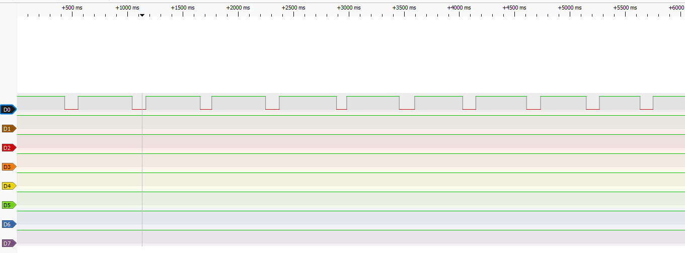
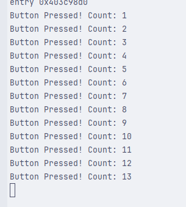
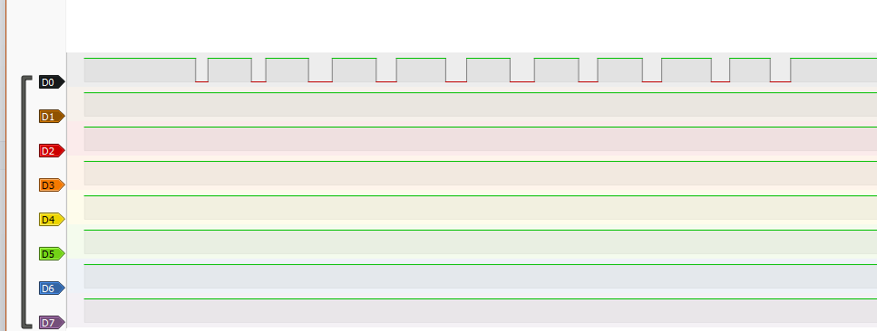
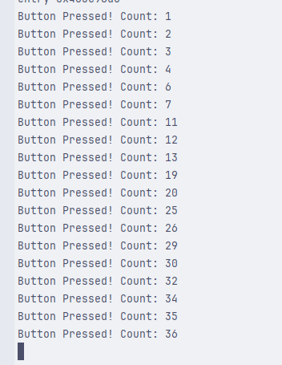

# Експеримент з брязкотом кнопки і логічним аналізатором

## Експеримент з кнопкою boot, яка на 0 піні:

Логічний аналізатор зловив 10 випадків натискання кнопки.
Брязкіту я не побачив на графіку, моєливо аналізатор не зміг зловити такий короткочасний випадок.

Але, Програмно зарахувалося 13 випадків.

## Експеримент із зовнішньою кнопкою, яка на 14 піні:

Тут також логічний аналізатор зловив 10 випадків натискання кнопки.

Але, програмно зарахувалося 36 випадків.

Питання для аналізу
Чи співпадає кількість імпульсів на графіку логічного аналізатора та в лічильнику мікроконтролера?

- Ні, не співпадає. На лічильнику мікроконтроллера більше імпульсів, ніж на графіку логічного аналізатора.

У яких випадках мікроконтролер «пропускає» частину брязкоту (якщо таке трапляється), а коли навпаки — «перераховує зайве»?

- Перераховує зайве при роботі через переривання: ISR спрацьовує на кожен фронт брязкоту (і при натисканні, і при відпусканні).
- Пропускає при опитуванні з `delay(10)`: брязкіт закінчується між двома перевірками.

Яка середня тривалість брязкоту для вашої кнопки?

- Виміряти не вдалося: на графіку логічного аналізатора брязкоту не було видно взагалі. Він дуже короткий (менше, ніж аналізатор зміг зафіксувати), але мікроконтролер його ловить, бо порахував зайві натискання.

Який мінімальний debounce (затримка / логіка фільтрації) був би достатній?

- 20-50 мс: після прийнятого натискання ігнорувати всі фронти протягом цього часу.
